# Infraestructura 1: DMZ con FortiGate

**Autor:** Omar Paulino · **Matrícula:** 20251325
**Plataforma:** GNS3 · FortiGate VM 7.0.9 · Cisco IOSvL2 · Ubuntu Cloud 24.04

---

## Video de demostración

ENLACE_DEL_VIDEO

En el video muestro la topología, la configuración del FortiGate y de los switches, y las pruebas de cada requisito:

- La VLAN 10 abre el Sistema de Caja, pero el Inventario le muestra la página de bloqueo.
- La VLAN 20 entra por SSH a los servidores y abre las dos webs.
- La DMZ no puede llegar a la LAN y solo sale a Internet para actualizarse.

---

## Contenido

1. [Propósito de la práctica](#1-propósito-de-la-práctica)
2. [Topología](#2-topología)
3. [Direccionamiento IP](#3-direccionamiento-ip)
4. [Cableado en GNS3](#4-cableado-en-gns3)
5. [Credenciales del laboratorio](#5-credenciales-del-laboratorio)
6. [Switches](#6-switches)
7. [FortiGate (FW-1325)](#7-fortigate-fw-1325)
8. [Servidores de la DMZ](#8-servidores-de-la-dmz)
9. [Equipos de usuario](#9-equipos-de-usuario)
10. [Resumen de las reglas de acceso](#10-resumen-de-las-reglas-de-acceso)
11. [Pruebas y resultados](#11-pruebas-y-resultados)
12. [Problemas que encontré y cómo los resolví](#12-problemas-que-encontré-y-cómo-los-resolví)

---

## 1. Propósito de la práctica

El objetivo de esta práctica fue **separar los servidores de una empresa en una DMZ** protegida por un FortiGate. Los usuarios internos solo pueden usar los servicios que les corresponden, y si un servidor queda comprometido no puede atacar a la red interna.

- En la **DMZ** hay tres servidores: la base de datos (DB-SERVER), el **Sistema de Caja** (WEB-CAJA) y el **Sistema de Inventario** (WEB-INVENTARIO).
- En la **VLAN 10** están los usuarios normales (PC-USER). Pueden usar la Caja, pero el Inventario les está prohibido y el FortiGate les muestra un aviso de violación de política.
- En la **VLAN 20** están los usuarios administrativos (PC-ADMIN). Son los únicos que pueden administrar los servidores por SSH.
- La DMZ **no tiene salida a Internet**, salvo hacia los repositorios de Ubuntu para actualizarse.

Con esto demuestro segmentación de red, mínimo privilegio, filtrado web y protección contra el movimiento lateral desde la DMZ.

### Requisitos y cómo los cumplí

| Requisito | Cómo lo cumplí |
| --- | --- |
| Servidores en una DMZ | `port4` del FortiGate con **rol DMZ** y su propio switch (SW-DMZ-1325). Los tres servidores están en `10.13.25.144/28` |
| Evitar fuga de tráfico de la DMZ a la LAN | Dos políticas DENY explícitas con log: `DENY-DMZ-to-USERS` y `DENY-DMZ-to-ADMIN` |
| La DMZ sin Internet, salvo actualizaciones | Política `DMZ-UPDATES`: solo HTTP/HTTPS hacia los objetos FQDN `archive.ubuntu.com` y `security.ubuntu.com`, con NAT. El DNS de la DMZ es el propio FortiGate |
| Solo la VLAN 20 administra por SSH | `ADMIN-SSH-to-DMZ` (ACCEPT) para la VLAN 20 y `DENY-SSH-USERS-to-DMZ` (DENY con log) para la VLAN 10 |
| La VLAN 10 no puede usar el Inventario y recibe un aviso | Perfil de **Web Filter** `WF-INVENTARIO-1325` con filtro estático de URL. El FortiGate responde con su página de bloqueo personalizada |
| La VLAN 10 no habla directo con la base de datos | `P2-BLOCK-USERS-to-DB-3306` (DENY MySQL) |
| Switches con VLAN y seguridad | VLAN 10/20/30, nativa 99, port-security, BPDU Guard, DHCP snooping, Dynamic ARP Inspection y puertos sin uso apagados |
| Dos redes de usuarios /25 con DHCP | VLAN 10 `10.13.25.0/25` y VLAN 20 `10.25.13.0/25`, cada una con su servidor DHCP en el FortiGate |

---

## 2. Topología

### Topología en GNS3

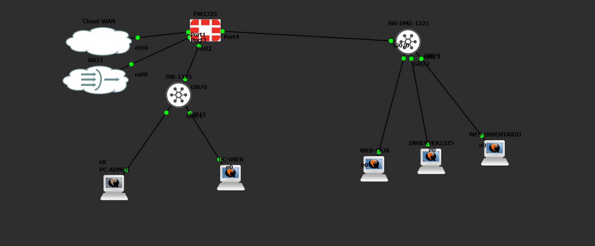

### Diagrama lógico

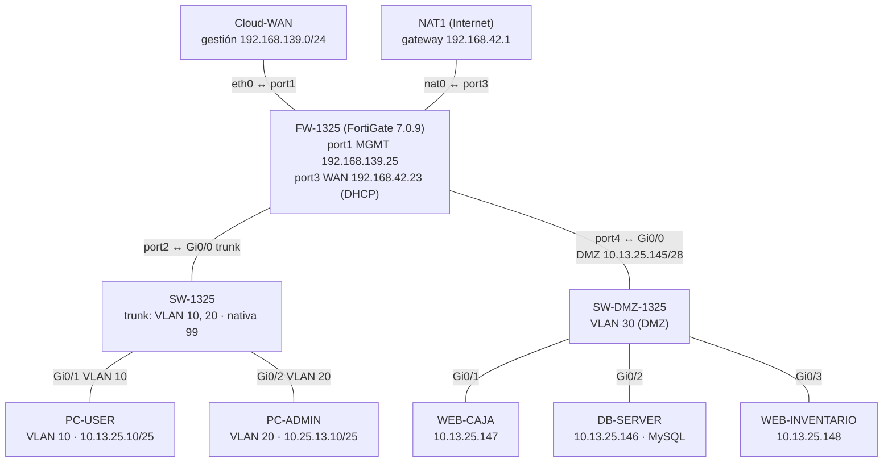

### Zonas de seguridad y qué tráfico se permite entre ellas

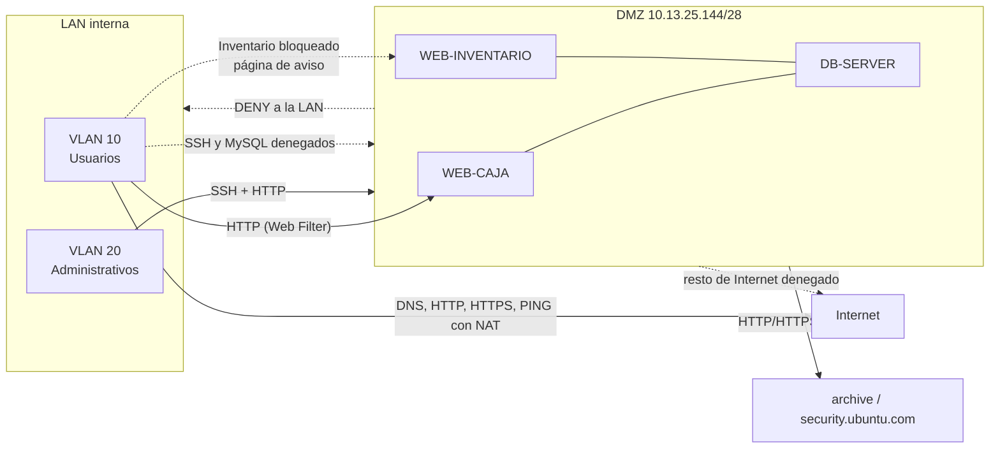

Las líneas continuas son tráfico permitido y las punteadas tráfico bloqueado. Las webs consultan la base de datos directamente por el SW-DMZ-1325, porque están en la misma red y ese tráfico no pasa por el FortiGate.

### Cómo decide el FortiGate una petición de la VLAN 10 a la DMZ

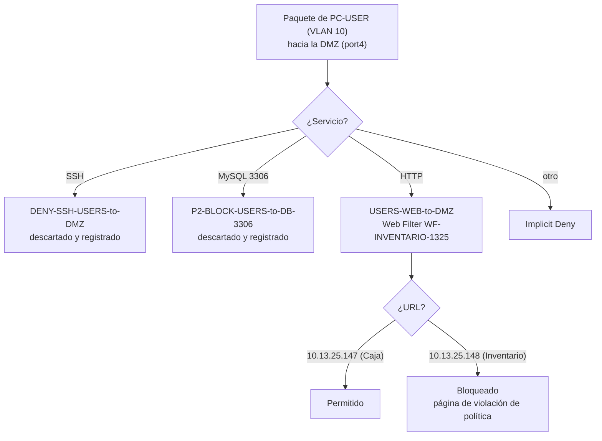

---

## 3. Direccionamiento IP

El direccionamiento lo derivé de mi matrícula **2025-1325**: `10.13.25.x` para los usuarios y la DMZ, y `10.25.13.x` (la matrícula al revés) para los administrativos.

| Segmento | Red | VLAN | Gateway (FortiGate) | Equipos |
| --- | --- | --- | --- | --- |
| Usuarios | 10.13.25.0/25 | 10 | 10.13.25.1 (VLAN10) | PC-USER por DHCP (rango .10 – .100) |
| Administrativos | 10.25.13.0/25 | 20 | 10.25.13.1 (VLAN20_WEB) | PC-ADMIN por DHCP (rango .10 – .100) |
| DMZ | 10.13.25.144/28 | 30 (solo en SW-DMZ-1325) | 10.13.25.145 (port4) | DB-SERVER .146 · WEB-CAJA .147 · WEB-INVENTARIO .148 |
| Gestión del FortiGate | 192.168.139.0/24 | — | — | FW-1325 port1: 192.168.139.25 |
| Salida a Internet (NAT1) | 192.168.42.0/24 | — | 192.168.42.1 | FW-1325 port3: 192.168.42.23 (DHCP) |

### Decisiones de diseño

- **La DMZ tiene su propio puerto y su propio switch.** En lugar de llevar la DMZ como una VLAN más por el mismo trunk de la LAN, la conecté a `port4` y a un switch dedicado (SW-DMZ-1325). Así la separación es también física: un error de configuración en el switch de la LAN no puede poner un servidor dentro de una VLAN de usuarios.
- **Por qué la VLAN 20 usa `10.25.13.0/25`.** La práctica pide redes de usuarios /25. La VLAN 10 ocupa `10.13.25.0 – .127`, y la otra mitad (`10.13.25.128/25`) se solaparía con la DMZ (`10.13.25.144/28`). Por eso usé la matrícula al revés.
- **La DMZ es una /28.** Da 14 direcciones útiles: suficientes para los tres servidores y el gateway, sin desperdiciar direcciones.
- **Los servidores usan IP fija** y como DNS el propio FortiGate (`10.13.25.145`), no 8.8.8.8. Así la DMZ no necesita hablar con ningún DNS de Internet.
- **El nombre `VLAN20_WEB`** de la interfaz se quedó de una práctica anterior; su alias es `ADMIN` y es la red de los administrativos.

---

## 4. Cableado en GNS3

| Desde | Puerto | Hasta | Puerto |
| --- | --- | --- | --- |
| Cloud-WAN | eth0 | FW1325 | port1 (MGMT) |
| NAT1 | nat0 | FW1325 | port3 (WAN) |
| FW1325 | port2 | SW-1325 | Gi0/0 (trunk) |
| FW1325 | port4 | SW-DMZ-1325 | Gi0/0 |
| SW-1325 | Gi0/1 | PC-USER | e0 (ens3) |
| SW-1325 | Gi0/2 | PC-ADMIN | e0 (ens3) |
| SW-DMZ-1325 | Gi0/1 | WEB-CAJA | e0 (ens3) |
| SW-DMZ-1325 | Gi0/2 | DBSERVER1325 | e0 (ens3) |
| SW-DMZ-1325 | Gi0/3 | WEB-INVENTARIO | e0 (ens3) |

La Cloud-WAN conecta el `port1` con mi Windows, desde donde entro a la GUI del FortiGate en `https://192.168.139.25`.

---

## 5. Credenciales del laboratorio

| Equipo | Usuario | Contraseña |
| --- | --- | --- |
| FW-1325 | admin | Forti1325! |
| SW-1325 y SW-DMZ-1325 | admin | Cisco1325! (enable secret igual) |
| Ubuntu (servidores y PCs) | ubuntu | Ubuntu1325! |
| MySQL (usuario de las webs) | webuser | Web1325!Pass |

---

## 6. Switches

Configuré los dos switches por CLI desde la consola de GNS3. Los comandos están en [`scripts/switches/`](DMZ-FortiGate/scripts/switches/) y los running-configs completos en [`running-configs/`](DMZ-FortiGate/running-configs/).

### 6.1 Seguridad común a los dos switches

| Medida | Comando | Para qué |
| --- | --- | --- |
| Contraseñas cifradas | `service password-encryption`, `enable secret`, `username admin secret` | Ninguna contraseña queda en texto plano en la configuración |
| CDP apagado | `no cdp run` | El switch no anuncia su modelo ni su IOS a los equipos conectados |
| Rapid PVST+ | `spanning-tree mode rapid-pvst` | Convergencia rápida de STP |
| Recuperación automática | `errdisable recovery cause psecure-violation` | Un puerto apagado por port-security vuelve solo pasados 5 minutos |
| DTP apagado | `switchport nonegotiate` | Nadie puede negociar un trunk desde un puerto de acceso |
| Port-security sticky | `switchport port-security mac-address sticky` | Cada puerto aprende una sola MAC y rechaza cualquier otra |
| PortFast + BPDU Guard | `spanning-tree portfast edge` y `bpduguard enable` | Los puertos de equipos suben al instante y se apagan si alguien conecta un switch |
| Puertos sin uso | VLAN 99 + `shutdown` | Un cable conectado a un puerto libre no da acceso a nada |
| SSH con cifrado fuerte | `ip ssh server algorithm encryption aes128-ctr ...` | Solo algoritmos AES-CTR |

### 6.2 SW-1325 (LAN: VLAN 10 y VLAN 20)

| Puerto | Descripción | Modo | VLAN | Seguridad |
| --- | --- | --- | --- | --- |
| Gi0/0 | Trunk hacia FW-1325 port2 | trunk dot1q, nonegotiate | permitidas 10, 20 · nativa 99 | `ip dhcp snooping trust`, `ip arp inspection trust` |
| Gi0/1 | PC-USER | access | 10 | port-security (violation restrict), BPDU Guard, límite DHCP 15 pps, límite ARP 100 pps |
| Gi0/2 | PC-ADMIN | access | 20 | Igual que Gi0/1 |
| Gi0/3, Gi1/0 – Gi1/3 | Sin uso | access | 99 | `shutdown` |

- **DHCP snooping en las VLAN 10 y 20:** el switch solo acepta respuestas DHCP que llegan por el trunk, es decir, del FortiGate. Un servidor DHCP falso conectado en un puerto de usuario queda ignorado.
- **Dynamic ARP Inspection en las VLAN 10 y 20:** compara cada ARP con la tabla de DHCP snooping y descarta los falsos. Así evito ataques de ARP spoofing (hombre en el medio) entre usuarios.
- **Nativa 99 y solo VLAN 10 y 20 permitidas en el trunk:** la VLAN 1 no viaja por el trunk, lo que evita el VLAN hopping por doble etiqueta.
- **Violation restrict:** si aparece otra MAC, el switch descarta sus tramas y lo registra, pero el puerto del usuario legítimo sigue funcionando.

### 6.3 SW-DMZ-1325 (DMZ)

| Puerto | Descripción | Modo | VLAN | Seguridad |
| --- | --- | --- | --- | --- |
| Gi0/0 | Uplink hacia FW-1325 port4 | access | 30 | nonegotiate |
| Gi0/1 | WEB-CAJA | access | 30 | port-security sticky, BPDU Guard |
| Gi0/2 | DB-SERVER | access | 30 | port-security sticky, BPDU Guard |
| Gi0/3 | WEB-INVENTARIO | access | 30 | port-security sticky, BPDU Guard |
| Gi1/0 – Gi1/3 | Sin uso | access | 99 | `shutdown` |

- El FortiGate recibe la DMZ **sin etiqueta** en `port4`, por eso el uplink es un puerto de acceso y no un trunk.
- En los servidores dejé la acción por defecto de port-security (**shutdown**): si alguien cambia un servidor por otro equipo, el puerto se apaga.
- En la DMZ no usé DHCP snooping ni DAI, porque los servidores tienen IP fija y no hay DHCP.

---

## 7. FortiGate (FW-1325)

**Nota:** toda la configuración del FortiGate la hice **de forma gráfica (GUI)** desde el navegador de mi Windows, entrando a `https://192.168.139.25`. El único paso por CLI fue darle la IP inicial a `port1` para poder entrar a la GUI. La configuración completa en texto (salida de los comandos `show`) está en [`running-configs/FW-1325.conf`](DMZ-FortiGate/running-configs/FW-1325.conf).

### 7.1 Arranque inicial por CLI

Entré por la consola con `admin` y la contraseña vacía, y el equipo me obligó a crear una nueva (`Forti1325!`). Después le di IP a `port1`:

```
config system interface
    edit "port1"
        set mode static
        set ip 192.168.139.25 255.255.255.0
        set allowaccess ping https ssh http
    next
end
```

### 7.2 System → Settings

| Campo | Valor |
| --- | --- |
| Hostname | `FW-1325` |

### 7.3 Network → Interfaces

| Interfaz | Alias | Tipo | Rol | Direccionamiento | Administrative Access |
| --- | --- | --- | --- | --- | --- |
| port1 | MGMT | Física | LAN | Manual: 192.168.139.25/24 | PING, HTTPS, SSH, HTTP |
| port2 | — | Física (padre de las VLAN) | — | Sin IP | — |
| VLAN10 | Usuarios | VLAN 802.1Q sobre port2, ID 10 | LAN | Manual: 10.13.25.1/25 | PING |
| VLAN20_WEB | ADMIN | VLAN 802.1Q sobre port2, ID 20 | LAN | Manual: 10.25.13.1/25 | PING |
| port3 | WAN | Física | WAN | DHCP (recibió 192.168.42.23/24 de NAT1) | PING |
| port4 | DMZ | Física | **DMZ** | Manual: 10.13.25.145/28 | PING |

- En las interfaces de usuarios y en la DMZ solo dejé **PING**. Nadie desde esas redes puede abrir la administración del FortiGate; solo se administra por `port1`.
- En la WAN también dejé solo PING, para no exponer la administración hacia Internet.
- En `port3` desactivé *Retrieve default gateway from server*. La ruta por defecto la creé a mano (sección 7.6).
- El **rol DMZ** de `port4` le indica al FortiGate que esa red es una zona expuesta, separada de la LAN, y así la identifica en los dashboards y en los logs.

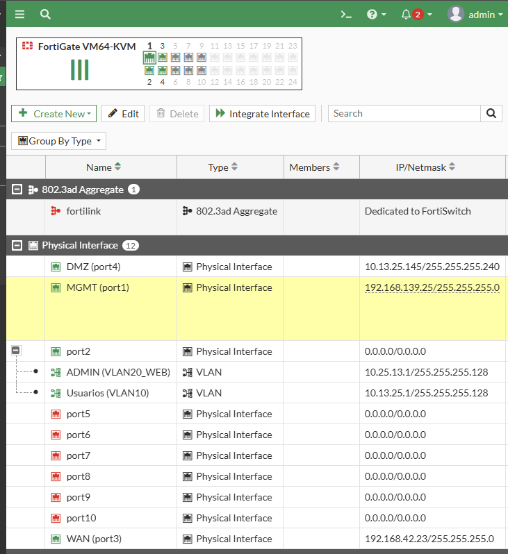

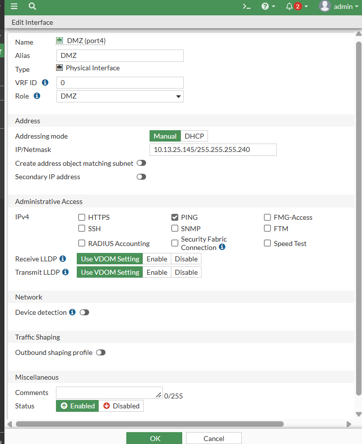

### 7.4 Servidores DHCP de las dos VLAN

Los activé dentro de cada interfaz, en la sección **DHCP Server**:

| Campo | VLAN10 (Usuarios) | VLAN20_WEB (ADMIN) |
| --- | --- | --- |
| DHCP status | Enabled | Enabled |
| Address range | 10.13.25.10 – 10.13.25.100 | 10.25.13.10 – 10.25.13.100 |
| Netmask | 255.255.255.128 | 255.255.255.128 |
| Default gateway | Same as Interface IP (10.13.25.1) | Same as Interface IP (10.25.13.1) |
| DNS server | Specify: 8.8.8.8 y 1.1.1.1 | Specify: 8.8.8.8 y 1.1.1.1 |
| Lease time | 86400 s (1 día) | 86400 s (1 día) |

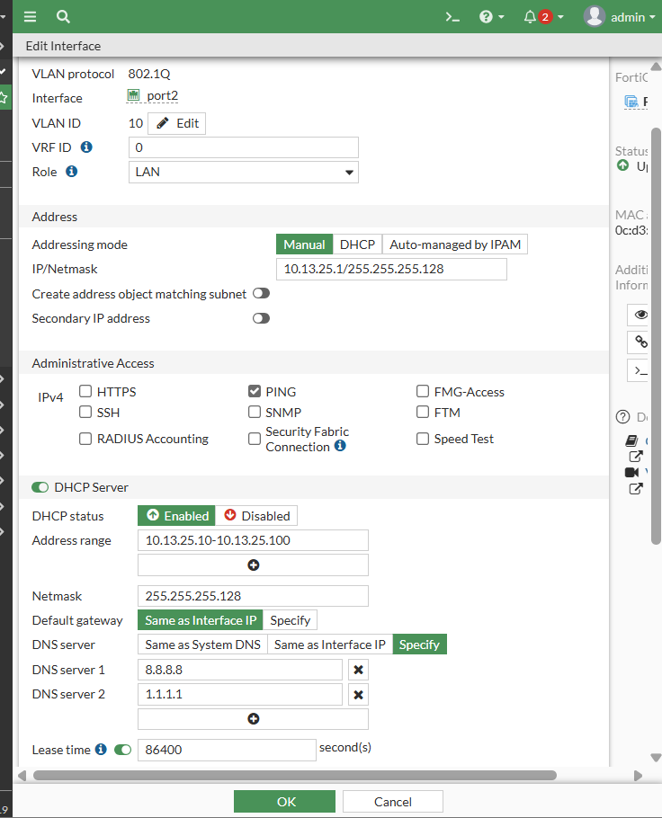

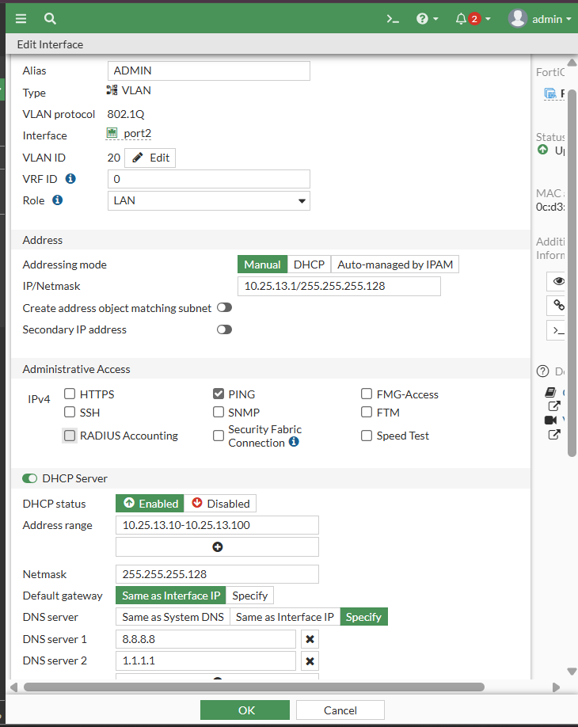

En *Dashboard → Network → DHCP* se ve que cada PC recibió la IP de su VLAN: PC-USER `10.13.25.10` y PC-ADMIN `10.25.13.10`.

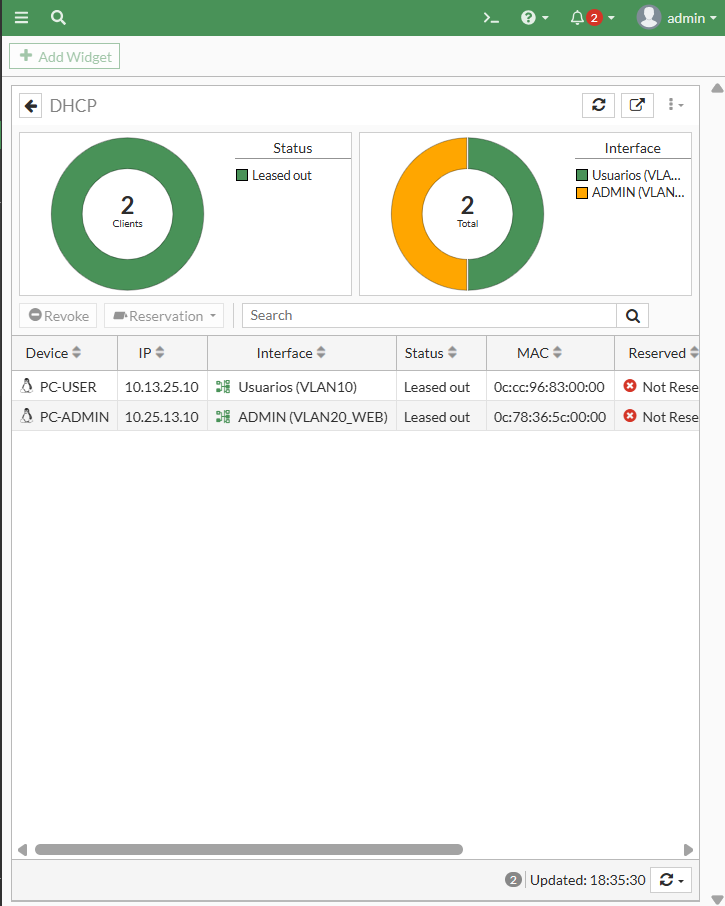

### 7.5 Network → DNS

**DNS del sistema:**

| Campo | Valor |
| --- | --- |
| DNS servers | Specify |
| Primary DNS server | 8.8.8.8 |
| Secondary DNS server | 1.1.1.1 |

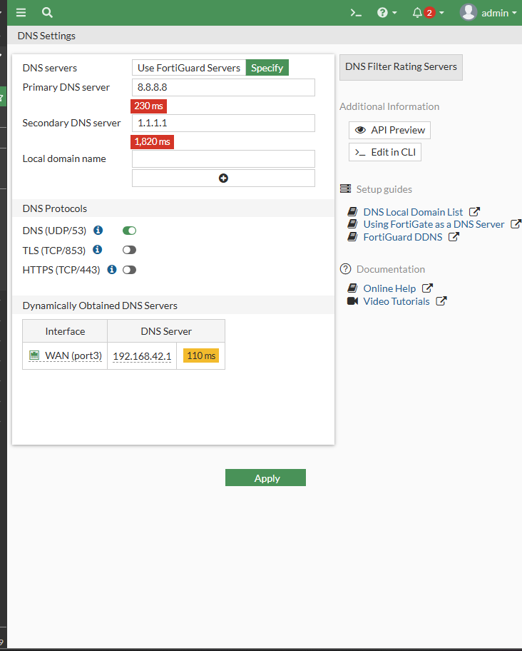

**El FortiGate como servidor DNS de la DMZ** (*System → Feature Visibility → DNS Database*, y luego *Network → DNS Servers → DNS Service on Interface → Create New*):

| Campo | Valor |
| --- | --- |
| Interface | DMZ (port4) |
| Mode | Forward to System DNS |

Con esto el FortiGate contesta las consultas DNS de los servidores en `10.13.25.145` y las reenvía a su DNS del sistema. Lo hice así por dos razones:

1. La DMZ no necesita ninguna regla hacia un DNS de Internet: la consulta va al propio FortiGate, no lo atraviesa.
2. El FortiGate resuelve los mismos nombres que usa en los objetos FQDN de los repositorios (sección 7.7), así las IP que obtiene el servidor coinciden con las que permite la política.

### 7.6 Network → Static Routes

| Destino | Gateway | Interfaz | Distancia |
| --- | --- | --- | --- |
| 0.0.0.0/0 | 192.168.42.1 | WAN (port3) | 10 |

Las redes de las VLAN y de la DMZ no necesitan ruta: están conectadas directamente al FortiGate.

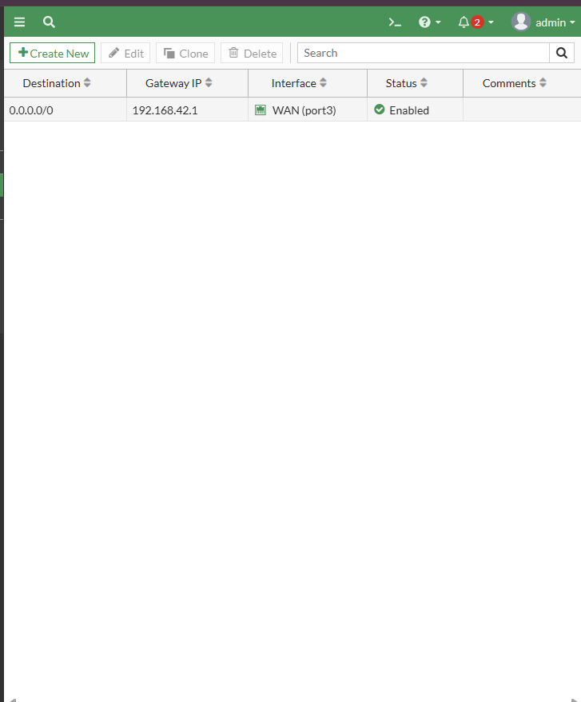

### 7.7 Policy & Objects → Addresses

| Nombre | Tipo | Valor | Interface |
| --- | --- | --- | --- |
| NET-USERS | Subnet | 10.13.25.0/25 | Usuarios (VLAN10) |
| NET-ADMIN | Subnet | 10.25.13.0/25 | ADMIN (VLAN20_WEB) |
| NET-DMZ | Subnet | 10.13.25.144/28 | any |
| SRV-DB | Subnet | 10.13.25.146/32 | any |
| SRV-CAJA | Subnet | 10.13.25.147/32 | any |
| SRV-INVENTARIO | Subnet | 10.13.25.148/32 | any |
| REPO-UBUNTU-ARCHIVE | FQDN | archive.ubuntu.com | any |
| REPO-UBUNTU-SECURITY | FQDN | security.ubuntu.com | any |
| UBUNTU-REPOS | Address Group | REPO-UBUNTU-ARCHIVE + REPO-UBUNTU-SECURITY | — |

Los demás objetos (`all`, `none`, `SSLVPN_TUNNEL_ADDR1`, los FQDN de Google y Microsoft, etc.) vienen por defecto en FortiOS.

**Sobre el campo Interface:** el campo *Interface* de un objeto limita en qué políticas se puede usar. Un objeto asociado a `VLAN10` solo se puede elegir en políticas que tengan `VLAN10` como entrada o salida. A los objetos de la DMZ les dejé **any** para poder usarlos tanto de destino (LAN → DMZ) como de origen (DMZ → LAN y DMZ → Internet).

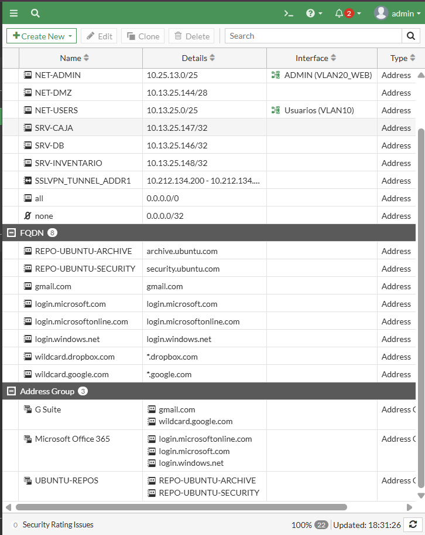

**Objetos FQDN de los repositorios.** Antes de crearlos confirmé en un servidor qué repositorios usa Ubuntu:

```bash
grep -h URIs /etc/apt/sources.list.d/*.sources
# URIs: http://archive.ubuntu.com/ubuntu/
# URIs: http://security.ubuntu.com/ubuntu/
```

Un objeto FQDN hace que el FortiGate resuelva el nombre y permita solo las IP que devuelve. Al pasar el mouse sobre el objeto se ven las IP resueltas:

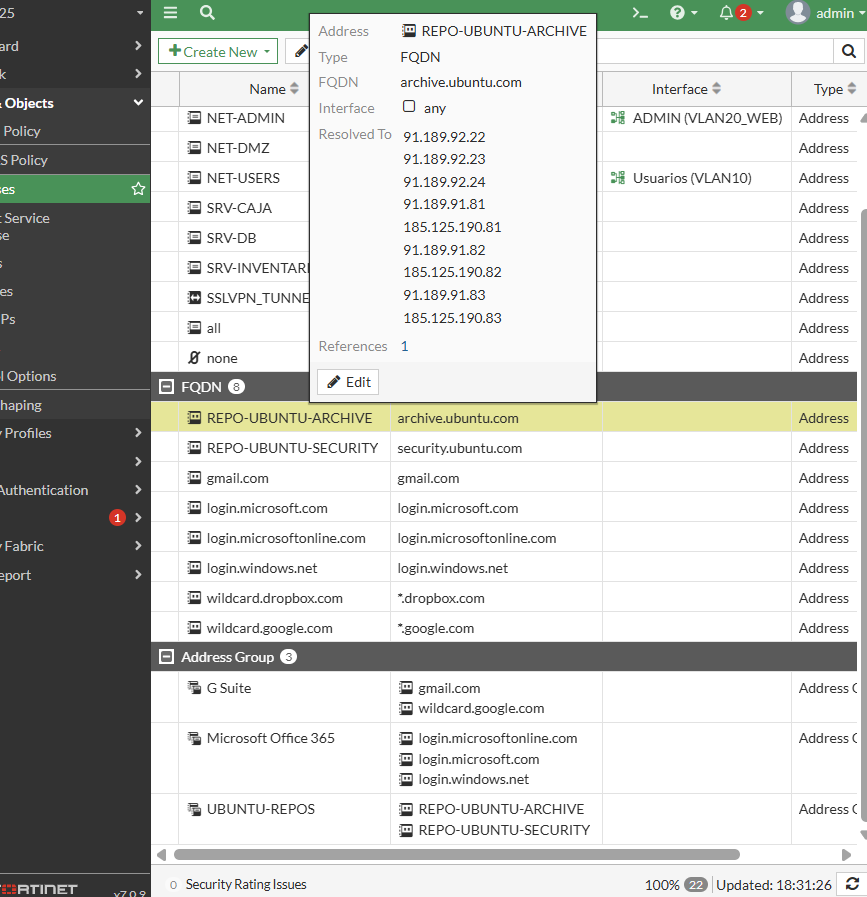

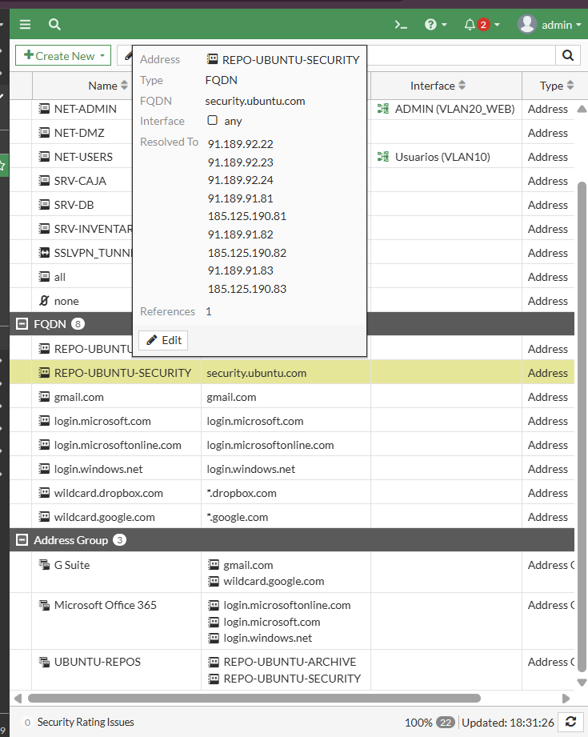

### 7.8 Security Profiles → Web Filter

**Perfil `WF-INVENTARIO-1325`** (*Security Profiles → Web Filter → Create New*):

| Campo | Valor |
| --- | --- |
| Name | WF-INVENTARIO-1325 |
| Feature set | Flow-based |
| Static URL Filter → URL Filter | ON |

**Entrada de la tabla URL Filter:**

| URL | Type | Action | Status |
| --- | --- | --- | --- |
| 10.13.25.148 | Simple | Block | Enable |

- El filtro estático de URL funciona sin licencia de FortiGuard, porque la lista de URL la defino yo.
- Cuando alguien de la VLAN 10 pide `http://10.13.25.148`, el FortiGate corta la conexión y le devuelve su página de bloqueo en lugar del Inventario.
- La Caja (`10.13.25.147`) no está en la lista, así que pasa normal.

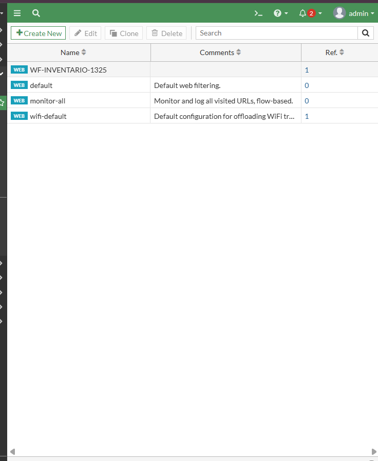

### 7.9 Página de bloqueo (Replacement Message)

Para que el usuario lea claramente que violó una política, edité la página en *System → Replacement Messages → Extended View → Security → URL Block Page*. Cambié el texto visible y dejé las variables `%%...%%`, que el FortiGate sustituye por los datos reales:

```html
<h1>ACCESO DENEGADO - Violacion de politica de seguridad</h1>
<p>El Sistema de Inventario esta restringido para la VLAN 10 (Usuarios).</p>
<p>Este intento quedo registrado por el firewall FW-1325.</p>
<p>URL solicitada: %%URL%%</p>
```

La página se ve completa porque las webs de la DMZ funcionan por **HTTP**. Con HTTPS y sin inspección profunda, el navegador mostraría un error de certificado en vez del aviso.

### 7.10 Policy & Objects → Firewall Policy

El FortiGate evalúa las políticas **de arriba hacia abajo** (vista *By Sequence*) y aplica la primera que coincide. Por eso las DENY específicas van antes que la ACCEPT general de cada par de interfaces.

| Orden | Nombre | Entrada → Salida | Origen → Destino | Servicio | Acción | NAT | Perfiles | Log |
| --- | --- | --- | --- | --- | --- | --- | --- | --- |
| 1 | ADMIN-SSH-to-DMZ | ADMIN (VLAN20_WEB) → DMZ (port4) | NET-ADMIN → NET-DMZ | SSH | ACCEPT | Disabled | — | All Sessions |
| 2 | ADMIN-WEB-to-DMZ | ADMIN (VLAN20_WEB) → DMZ (port4) | NET-ADMIN → SRV-CAJA, SRV-INVENTARIO | HTTP | ACCEPT | Disabled | — | All Sessions |
| 3 | DENY-SSH-USERS-to-DMZ | Usuarios (VLAN10) → DMZ (port4) | NET-USERS → NET-DMZ | SSH | DENY | — | — | Violation Traffic |
| 4 | P2-BLOCK-USERS-to-DB-3306 | Usuarios (VLAN10) → DMZ (port4) | NET-USERS → SRV-DB | MYSQL | DENY | — | — | Violation Traffic |
| 5 | USERS-WEB-to-DMZ | Usuarios (VLAN10) → DMZ (port4) | NET-USERS → SRV-CAJA, SRV-INVENTARIO | HTTP | ACCEPT | Disabled | Web Filter `WF-INVENTARIO-1325` + SSL `certificate-inspection` | All Sessions |
| 6 | DENY-DMZ-to-USERS | DMZ (port4) → Usuarios (VLAN10) | NET-DMZ → all | ALL | DENY | — | — | Violation Traffic |
| 7 | DENY-DMZ-to-ADMIN | DMZ (port4) → ADMIN (VLAN20_WEB) | NET-DMZ → all | ALL | DENY | — | — | Violation Traffic |
| 8 | DMZ-UPDATES | DMZ (port4) → WAN (port3) | NET-DMZ → UBUNTU-REPOS | HTTP, HTTPS | ACCEPT | **Enabled** | — | All Sessions |
| 9 | P3-USERS-to-INTERNET | Usuarios (VLAN10) → WAN (port3) | NET-USERS → all | DNS, HTTP, HTTPS, PING | ACCEPT | **Enabled** | — | All Sessions |
| — | Implicit Deny | any → any | all → all | ALL | DENY | — | — | — |

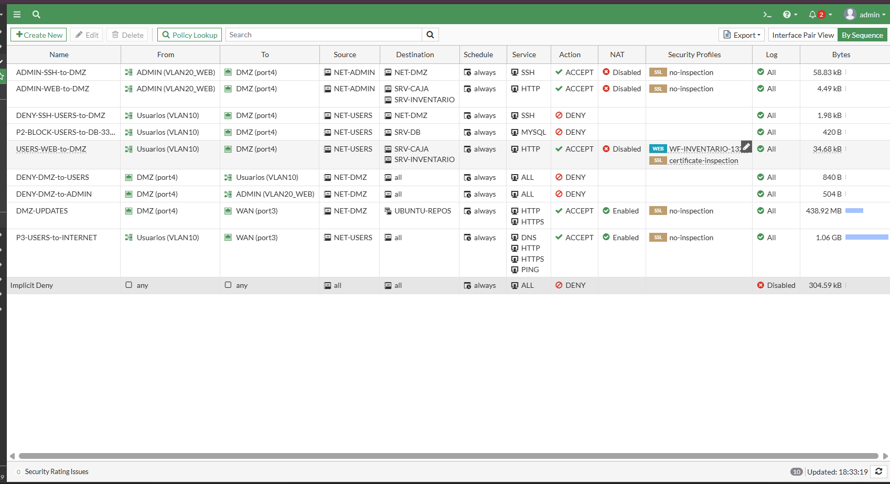

**Explicación de cada regla:**

- **1. ADMIN-SSH-to-DMZ:** es la única política que deja pasar SSH hacia los servidores. Solo la VLAN 20 administra la DMZ.
- **2. ADMIN-WEB-to-DMZ:** los administrativos abren la Caja y el Inventario sin filtro. Sirve de contraste: el Inventario existe y funciona, pero no para la VLAN 10.
- **3. DENY-SSH-USERS-to-DMZ:** bloqueo explícito del SSH desde la VLAN 10, con registro de cada intento. Lo puse explícito, y no solo dejé que cayera en el Implicit Deny, para que cada intento quede en el log con el nombre de la regla.
- **4. P2-BLOCK-USERS-to-DB-3306:** los usuarios no pueden hablar directo con MySQL. Solo las webs consultan la base de datos.
- **5. USERS-WEB-to-DMZ:** deja pasar HTTP hacia las dos webs, pero con el perfil `WF-INVENTARIO-1325`, que bloquea `10.13.25.148` y muestra la página de violación. El FortiGate exige un perfil SSL al usar Web Filter; con HTTP `certificate-inspection` no interviene.
- **6 y 7. DENY-DMZ-to-USERS y DENY-DMZ-to-ADMIN (anti-fuga):** si un servidor queda comprometido, no puede iniciar conexiones hacia ninguna de las dos VLAN. Las respuestas a las sesiones permitidas (por ejemplo, el SSH desde la VLAN 20) siguen funcionando, porque el FortiGate es *stateful*: la respuesta pertenece a una sesión ya aceptada. Son dos políticas porque cada una tiene una sola interfaz de salida.
- **8. DMZ-UPDATES:** la DMZ sale a Internet únicamente hacia los repositorios de Ubuntu, por HTTP y HTTPS, con NAT (origen traducido a la IP de `port3`). De ahí vienen las actualizaciones de Apache, PHP y MySQL.
- **9. P3-USERS-to-INTERNET:** la VLAN 10 navega por Internet con NAT, limitada a DNS, HTTP, HTTPS y PING.
- **Implicit Deny:** descarta todo lo demás. Aquí caen, por ejemplo, la DMZ intentando abrir cualquier otra página de Internet, la VLAN 10 intentando llegar a la VLAN 20, o cualquier conexión que entre desde la WAN.

Las políticas ACCEPT sin perfiles de seguridad aparecen en la GUI con el perfil SSL `no-inspection`, que es el valor por defecto.

---

## 8. Servidores de la DMZ

Los tres son Ubuntu Cloud 24.04 con IP fija, gateway `10.13.25.145` y DNS `10.13.25.145` (el FortiGate). Los archivos están en [`scripts/servidores/`](DMZ-FortiGate/scripts/servidores/).

### 8.1 DB-SERVER (10.13.25.146)

**Red** (`/etc/netplan/`):

```yaml
network:
  version: 2
  ethernets:
    ens3:
      mtu: 1300
      addresses: [10.13.25.146/28]
      routes:
        - to: default
          via: 10.13.25.145
      nameservers:
        addresses: [10.13.25.145]
```

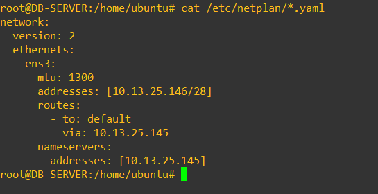

**Base de datos.** MySQL con la base `tienda` y la tabla `productos`. Creé un usuario de **solo lectura** para cada web, atado a su IP, y agregué la columna de existencias que muestra el Inventario ([`db-server_setup.sql`](DMZ-FortiGate/scripts/servidores/db-server_setup.sql)):

```sql
USE tienda;
CREATE USER 'webuser'@'10.13.25.147' IDENTIFIED WITH mysql_native_password BY 'Web1325!Pass';
CREATE USER 'webuser'@'10.13.25.148' IDENTIFIED WITH mysql_native_password BY 'Web1325!Pass';
GRANT SELECT ON tienda.* TO 'webuser'@'10.13.25.147';
GRANT SELECT ON tienda.* TO 'webuser'@'10.13.25.148';
ALTER TABLE productos ADD COLUMN stock INT NOT NULL DEFAULT 0;
UPDATE productos SET stock = 12 WHERE id = 1;
UPDATE productos SET stock = 80 WHERE id = 2;
UPDATE productos SET stock = 45 WHERE id = 3;
FLUSH PRIVILEGES;
```

| Decisión | Por qué |
| --- | --- |
| Usuario atado a la IP de cada web (`'webuser'@'10.13.25.147'`) | Aunque alguien conozca la contraseña, MySQL solo la acepta desde las dos webs |
| Solo `SELECT` | Las webs solo muestran datos; si una web es comprometida, no puede modificar ni borrar la base |
| `mysql_native_password` | Compatible con la extensión `mysqli` de PHP sin configurar SSL entre la web y la base |

MySQL escucha en `10.13.25.146:3306`. Las webs llegan a él directamente por el SW-DMZ-1325.

### 8.2 WEB-CAJA (10.13.25.147)

**Red:**

```yaml
network:
  version: 2
  ethernets:
    ens3:
      addresses: [10.13.25.147/28]
      routes:
        - to: default
          via: 10.13.25.145
      nameservers:
        addresses: [10.13.25.145]
```

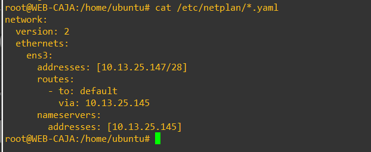

**Aplicación.** Apache + PHP con una página que lista productos y precios desde la base de datos ([`web-caja_index.php`](DMZ-FortiGate/scripts/servidores/web-caja_index.php)):

```php
<?php
mysqli_report(MYSQLI_REPORT_OFF);
echo "<h1>Sistema de Caja - Lab 2025-1325</h1>";
$c = new mysqli("10.13.25.146", "webuser", "Web1325!Pass", "tienda");
if ($c->connect_error) { die("Error DB: " . $c->connect_error); }
$r = $c->query("SELECT nombre, precio FROM productos");
echo "<table border='1'><tr><th>Producto</th><th>Precio</th></tr>";
while ($f = $r->fetch_assoc()) {
  echo "<tr><td>" . htmlspecialchars($f['nombre']) . "</td><td>" . $f['precio'] . "</td></tr>";
}
echo "</table>";
```

- La consulta **no recibe parámetros del usuario**, así que no es inyectable.
- `htmlspecialchars` evita que un dato de la base se interprete como HTML o JavaScript (XSS).

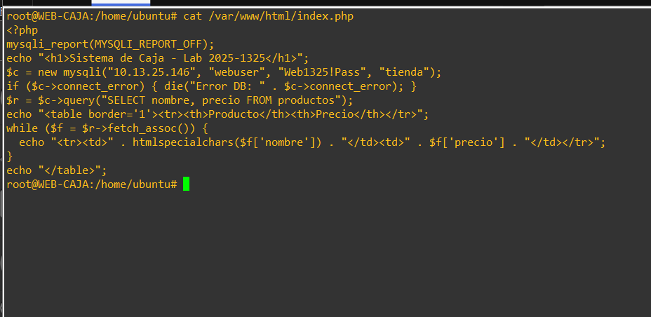

**Apache solo por HTTP:**

```bash
sudo a2ensite 000-default
sudo a2dissite default-ssl
sudo systemctl reload apache2
curl http://localhost/
```

Apagué el sitio HTTPS porque las políticas solo permiten HTTP hacia las webs. Así el bloqueo del Web Filter se ve sin avisos de certificado.

### 8.3 WEB-INVENTARIO (10.13.25.148)

Es igual que la Caja, con su IP y una página que muestra las existencias ([`web-inventario_index.php`](DMZ-FortiGate/scripts/servidores/web-inventario_index.php)):

```yaml
network:
  version: 2
  ethernets:
    ens3:
      addresses: [10.13.25.148/28]
      routes:
        - to: default
          via: 10.13.25.145
      nameservers:
        addresses: [10.13.25.145]
```

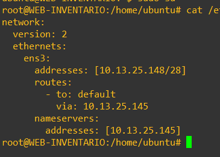

```php
<?php
mysqli_report(MYSQLI_REPORT_OFF);
echo "<h1>Sistema de Inventario - Lab 2025-1325</h1>";
$c = new mysqli("10.13.25.146", "webuser", "Web1325!Pass", "tienda");
if ($c->connect_error) { die("Error DB: " . $c->connect_error); }
$r = $c->query("SELECT nombre, stock FROM productos");
echo "<table border='1'><tr><th>Producto</th><th>Existencias</th></tr>";
while ($f = $r->fetch_assoc()) {
  echo "<tr><td>" . htmlspecialchars($f['nombre']) . "</td><td>" . $f['stock'] . "</td></tr>";
}
echo "</table>";
```

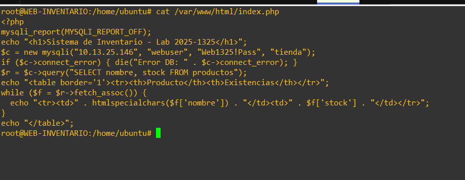

### 8.4 SSH en los tres servidores

La imagen de Ubuntu Cloud trae el acceso SSH por contraseña desactivado. Para la administración desde la VLAN 20 lo activé en los tres servidores:

```bash
echo 'PasswordAuthentication yes' | sudo tee /etc/ssh/sshd_config.d/01-lab.conf
sudo systemctl restart ssh
```

El archivo `01-lab.conf` se lee antes que el de cloud-init, por eso su valor es el que se aplica. Que el SSH esté activo no lo expone: el FortiGate solo deja llegar a él desde la VLAN 20.

---

## 9. Equipos de usuario

### 9.1 PC-USER (VLAN 10)

Ubuntu Cloud 24.04 con IP por DHCP en `ens3`. El SW-1325 lo pone en la VLAN 10 y el FortiGate le entregó `10.13.25.10/25`, con gateway `10.13.25.1`.

```yaml
network:
  version: 2
  ethernets:
    ens3:
      dhcp4: true
      dhcp-identifier: mac
```

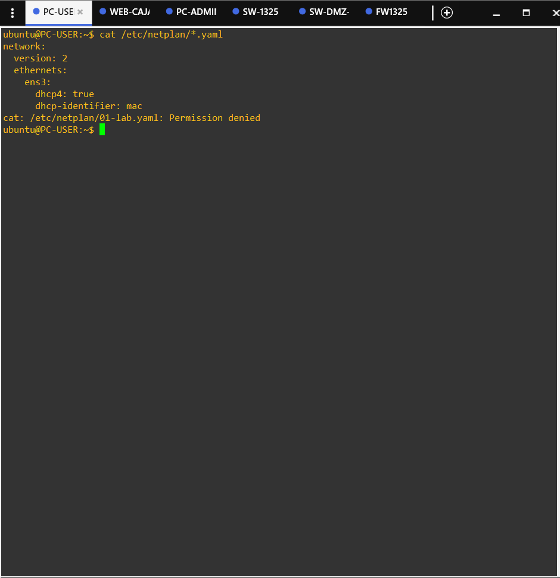

`dhcp-identifier: mac` hace que el equipo se identifique ante el DHCP por su MAC. Así recibe siempre la misma IP y el lease aparece con su MAC en el FortiGate.

Para ver la página de bloqueo renderizada en la consola instalé un navegador de texto: `sudo apt install -y w3m`.

### 9.2 PC-ADMIN (VLAN 20)

Igual que el PC-USER, pero conectado al Gi0/2 (VLAN 20). Recibió `10.25.13.10/25` con gateway `10.25.13.1`. Le cambié el nombre con `hostnamectl set-hostname PC-ADMIN` y agregué `mtu: 1300` en su netplan.

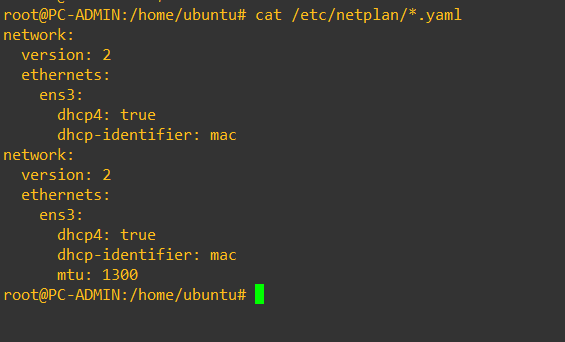

---

## 10. Resumen de las reglas de acceso

| Origen | Destino | Servicio | Resultado | Política |
| --- | --- | --- | --- | --- |
| VLAN 10 | WEB-CAJA | HTTP | Permitido | USERS-WEB-to-DMZ |
| VLAN 10 | WEB-INVENTARIO | HTTP | **Bloqueado con página de aviso** | USERS-WEB-to-DMZ (Web Filter) |
| VLAN 10 | DMZ | SSH | Bloqueado y registrado | DENY-SSH-USERS-to-DMZ |
| VLAN 10 | DB-SERVER | MySQL 3306 | Bloqueado y registrado | P2-BLOCK-USERS-to-DB-3306 |
| VLAN 10 | Internet | DNS, HTTP, HTTPS, PING | Permitido con NAT | P3-USERS-to-INTERNET |
| VLAN 20 | DMZ | SSH | Permitido | ADMIN-SSH-to-DMZ |
| VLAN 20 | WEB-CAJA y WEB-INVENTARIO | HTTP | Permitido | ADMIN-WEB-to-DMZ |
| DMZ | VLAN 10 y VLAN 20 | Todo | Bloqueado y registrado | DENY-DMZ-to-USERS / DENY-DMZ-to-ADMIN |
| DMZ | Repositorios de Ubuntu | HTTP, HTTPS | Permitido con NAT | DMZ-UPDATES |
| DMZ | Resto de Internet | Todo | Bloqueado | Implicit Deny |
| VLAN 10 | VLAN 20 | Todo | Bloqueado | Implicit Deny |
| Internet | Cualquier red interna | Todo | Bloqueado | Implicit Deny |
| Webs | DB-SERVER | MySQL 3306 | Permitido (misma red, no pasa por el FortiGate) | — |

---

## 11. Pruebas y resultados

La demostración completa está en el [video](#video-de-demostración). Los comandos que usé están en [`scripts/servidores/pruebas.sh`](DMZ-FortiGate/scripts/servidores/pruebas.sh).

| # | Requisito | Equipo | Comando | Resultado | Registro en el FortiGate |
| --- | --- | --- | --- | --- | --- |
| 1 | Dos redes /25 con DHCP | PC-USER y PC-ADMIN | `ip -br a` | `10.13.25.10/25` y `10.25.13.10/25` | Dashboard → DHCP |
| 2 | La VLAN 10 usa la Caja | PC-USER | `curl http://10.13.25.147` | Tabla "Sistema de Caja" | USERS-WEB-to-DMZ |
| 3 | Inventario bloqueado con aviso | PC-USER | `w3m http://10.13.25.148` | Página de violación de política | Web Filter: `http://10.13.25.148/` blocked |
| 4 | SSH denegado a la VLAN 10 | PC-USER | `ssh -o ConnectTimeout=5 ubuntu@10.13.25.147` | Connection timed out | DENY-SSH-USERS-to-DMZ |
| 5 | La VLAN 10 sin acceso a la DB | PC-USER | `nc -zv -w3 10.13.25.146 3306` | Timeout | P2-BLOCK-USERS-to-DB-3306 |
| 6 | SSH solo desde la VLAN 20 | PC-ADMIN | `ssh ubuntu@10.13.25.147` | Entra; `hostname` → WEB-CAJA | ADMIN-SSH-to-DMZ |
| 7 | El Inventario existe | PC-ADMIN | `curl http://10.13.25.148` | Tabla "Sistema de Inventario" | ADMIN-WEB-to-DMZ |
| 8 | Sin fuga de la DMZ a la LAN | WEB-CAJA | `ping -c3 10.13.25.10` y `ping -c3 10.25.13.10` | 100% de pérdida | DENY-DMZ-to-USERS / DENY-DMZ-to-ADMIN |
| 9 | La DMZ se actualiza | WEB-CAJA | `sudo apt update` | Descarga las listas de paquetes | DMZ-UPDATES |
| 10 | La DMZ no tiene más Internet | WEB-CAJA | `curl -m5 http://example.com` | Timeout | Implicit Deny |

### 11.1 Evidencia en los logs del FortiGate

En *Log & Report → Forward Traffic* se ve cada sesión con la política que la atendió:

- los intentos de SSH de PC-USER (`10.13.25.10`) a `10.13.25.147` denegados por **DENY-SSH-USERS-to-DMZ**;
- los pings de la DMZ hacia `10.13.25.10` y `10.25.13.10` denegados por **DENY-DMZ-to-USERS** y **DENY-DMZ-to-ADMIN**;
- el tráfico de actualización hacia `security.ubuntu.com` aceptado por **DMZ-UPDATES**;
- la navegación de PC-USER hacia `8.8.8.8` aceptada por **P3-USERS-to-INTERNET**.

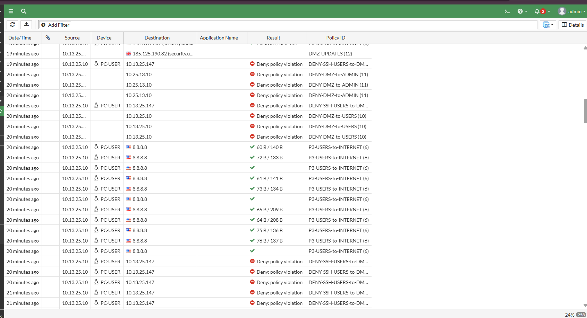

En *Log & Report → Web Filter* aparece cada intento de PC-USER de abrir el Inventario, con la acción **blocked** sobre `http://10.13.25.148/`:

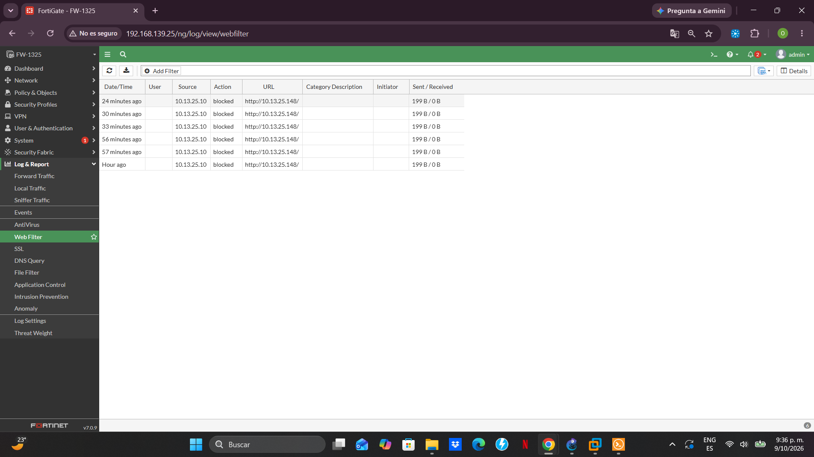

### 11.2 Verificación de los switches

```
show vlan brief            ! VLAN 10, 20 y 99 en SW-1325 · VLAN 30 y 99 en SW-DMZ-1325
show interfaces trunk      ! Gi0/0 de SW-1325: nativa 99, permitidas 10 y 20
show port-security         ! una MAC sticky por puerto de equipo
show ip dhcp snooping      ! snooping activo en VLAN 10 y 20, Gi0/0 trusted
show interfaces status     ! puertos sin uso en estado disabled
```

---

## 12. Problemas que encontré y cómo los resolví

| Problema | Causa | Solución |
| --- | --- | --- |
| No podía usar el objeto `NET-DMZ` en las políticas de `port4` | El objeto estaba asociado a otra interfaz, y el campo *Interface* limita en qué políticas se puede usar | Cambié su *Interface* a **any**, igual que en los demás objetos de la DMZ |
| Al crear la segunda red de usuarios, `10.13.25.128/25` chocaba con la DMZ | La DMZ `10.13.25.144/28` está dentro de ese bloque | Usé `10.25.13.0/25` para la VLAN 20 |
| La página de bloqueo salía con el texto en inglés por defecto | No había editado el Replacement Message | Personalicé *URL Block Page* (sección 7.9) |
